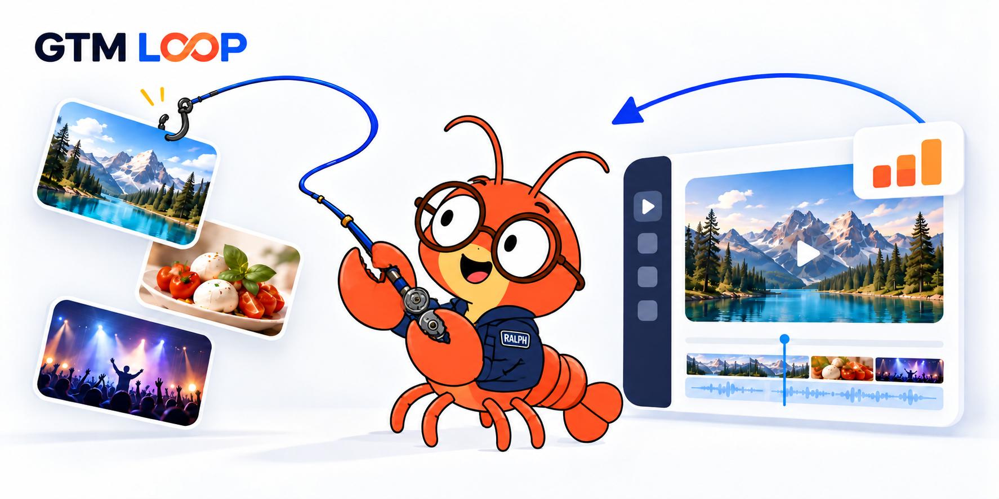
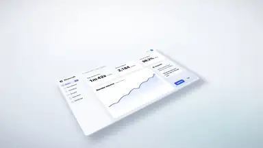
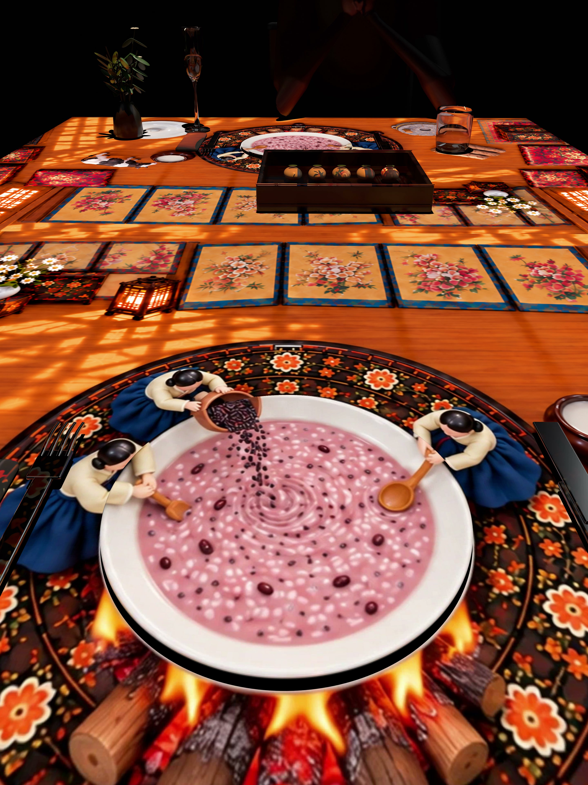
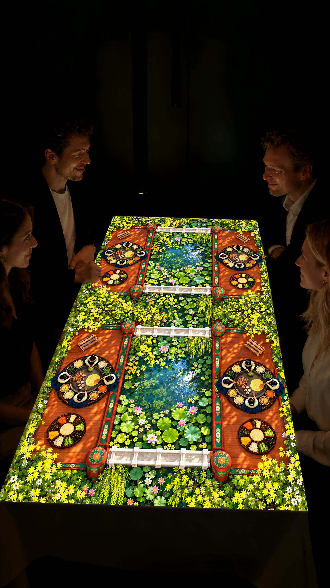

<div align="center">

# GTM Loop



### 무료 소스에서 훅을 찾고, Higgsfield로 고퀄 콘텐츠를 빠르게.

**소스는 무료로. 훅은 날카롭게. 제작은 Higgsfield로.**

좋은 장면을 찾아, 우리 브랜드의 다음 콘텐츠로 바꾸는 GTM 제작 루프.

**GA → Meta 광고 라이브러리 → 무료 소스 탐색 → Pexels · Higgsfield · Genjutsu → 다시 GA**

[](#적용-프로젝트--soban-tales)
[](#루프에서-파생되는-기능)
[](#현재-구현-범위)

[핵심 루프](#핵심-루프) · [샷 갤러리](#샷-갤러리) · [스킬 연결](#스킬이-연결되는-구조) · [폴더 구조](#폴더-구조) · [크레딧](#크레딧과-출처)

</div>

---

## 핵심 루프

**무료 소스에서 시선을 잡을 장면을 찾고, Higgsfield로 빠르고 쉽게 높은 퀄리티의 콘텐츠를 만드는 것. 이것이 GTM Loop가 지향하는 제작 방식입니다.**

빈 화면에서 시작하는 대신 Pexels와 웹의 사용 가능한 소스를 출발점으로 삼습니다. Meta 광고 라이브러리에서 훅·구도·전환의 힌트를 얻고, 우리 제품의 메시지와 시각 표현으로 재구성합니다. Higgsfield를 중심으로 필요한 장면을 만들고 편집해, 다음 콘텐츠 실험까지의 과정을 줄입니다.

**무엇을 만들지는 반응이 알려줍니다.** GA에서 국가·콘텐츠별 반응을 비교하고, 잘 읽힌 훅과 시각 표현을 다음 변형의 가설로 삼습니다. 수집에서 끝내지 않고 **소스 → 훅 → 재제작 → 반응 → 다음 훅**으로 반복합니다.

<sub>‘무료’는 이용 조건을 확인한 소스에 대한 표현입니다. Higgsfield 등의 생성·편집 비용까지 무료라는 뜻은 아니며, 제작 속도와 품질은 사용하는 소스·모델·작업에 따라 검토합니다.</sub>

Soban Tales는 이 루프를 적용하는 현재 프로젝트입니다. 영상 제작·Blender/VFX·카피·광고·SEO·협업 검토는 핵심 루프에서 필요에 따라 이어지는 기능입니다.

```text
PRODUCT CONTEXT: product / country / goal / creative_id

┌───────────────────────┐    ┌───────────────────────┐    ┌───────────────────────┐    ┌───────────────────────┐
│      01 / ANALYZE     │    │      02 / COLLECT     │    │      03 / SOURCE      │    │      04 / REMAKE      │
├───────────────────────┤    ├───────────────────────┤    ├───────────────────────┤    ├───────────────────────┤
│           GA          │ -> │    META AD LIBRARY    │ -> │   WEB / FREE CONTENT  │ -> │  PEXELS / HIGGSFIELD  │
│   Country / Content   │    │   Hook / Composition  │    │    Match / License    │    │        GENJUTSU       │
│    Visual response    │    │  Transition / Message │    │    Source / Credit    │    │     Edit / Review     │
└───────────┬───────────┘    └───────────────────────┘    └───────────────────────┘    └───────────┬───────────┘
            │                                                                                      │
            └──────────────────  ◀ PUBLISH / creative_id / RESULTS / LEARNINGS  ───────────────────┘
```

공통 제품 맥락을 바탕으로 **분석 → 수집 → 소스 탐색 → 재제작**을 진행하고, 배포 결과와 학습을 다음 GA 분석으로 연결합니다.

| 단계 | 무엇을 하는가 | 다음 단계에 남기는 것 |
|---|---|---|
| **01 · 반응 분석** | GA에서 국가·콘텐츠·유입과 계측된 반응 비교 | 반응 요약, 비교 조건, 다음 실험 가설 |
| **02 · 좋은 콘텐츠 수집** | Meta 광고 라이브러리에서 훅·구도·편집·메시지 관찰 | 원본 링크, 관찰한 장점, 가져올 표현 원리 |
| **03 · 비슷한 무료 소스 찾기** | 인터넷에서 유사한 장면·이미지·영상 탐색 | 소스 후보, 출처, 이용 조건, 적합성 |
| **04 · 우리 콘텐츠로 재제작** | Pexels 소스를 검토하고 Higgsfield·Genjutsu 등을 활용하는 제작 경로 선택 | 우리 제품의 변형안, 편집 원본, 검토 기록 |
| **↺ · 다시 측정** | 배포 결과를 콘텐츠 ID·UTM·변형 정보와 연결 | 다음 국가·콘텐츠·시각 표현의 우선순위 |

시각 표현은 훅·색·구도·카메라·전환 등의 태그로 콘텐츠 ID와 연결해 비교합니다. GA 데이터만으로 어느 프레임 때문에 반응했는지 단정하지 않습니다. 광고 라이브러리의 좋은 레퍼런스도 실제 성과가 검증된 광고라는 뜻은 아닙니다.

**연결 상태와 자동 실행 범위는 별개입니다.** 현재는 스킬·가이드 중심이며 이 전체 루프가 자동 실행되는 엔진은 아닙니다. [핵심 루프 운영 가이드](docs/gtm-loop.md)에서 입력·산출물·검토 지점을 확인하세요.

## 샷 갤러리

레퍼런스의 표현 원리를 우리 콘텐츠로 바꾸는 데 사용하는 **video-shotcraft 원작 샘플**입니다. 아래 이미지는 Soban Tales의 완성 영상이나 이 프로젝트의 성과 사례가 아닙니다. 각 카드를 누르면 동봉한 샷 라이브러리로 이동합니다.

<table>
<tr>
<td width="50%" align="center">
<h3>Opening &amp; Brand</h3>
<a href="skills/video-shotcraft/references/shots"></a>
<p><b>첫 화면에서 시선을 잡는 훅</b><br>텍스트 마스크 · 브랜드 등장 · 제품 공개</p>
</td>
<td width="50%" align="center">
<h3>Camera &amp; Composition</h3>
<a href="skills/video-shotcraft/references/shots/camera"></a>
<p><b>무엇을 먼저 보여줄지 설계</b><br>깊이 · 프레이밍 · 시선 유도</p>
</td>
</tr>
<tr>
<td width="50%" align="center">
<h3>Transitions</h3>
<a href="skills/video-shotcraft/references/shots"></a>
<p><b>장면과 메시지를 연결하는 전환</b><br>가림 · 형태 변화 · 동작 연결</p>
</td>
<td width="50%" align="center">
<h3>Typography &amp; Rhythm</h3>
<a href="skills/video-shotcraft/references/shots/typography"></a>
<p><b>문구가 읽히는 시간과 리듬</b><br>타이포 · 박자 · 사운드 디자인</p>
</td>
</tr>
</table>

이미지·샷 레시피 출처: **[Vincentwei1021/video-shotcraft](https://github.com/Vincentwei1021/video-shotcraft)** · [원작 동적 갤러리](https://vincentwei1021.github.io/video-shotcraft/) · [Apache-2.0](skills/video-shotcraft/LICENSE). 광고용 카메라 연출을 식탁 투사 마스터에 그대로 적용하지 않습니다.

### 제작 경로 두 가지

무료 소스를 찾은 뒤, 현재 요청에 맞춰 제작 경로를 선택합니다.

| 경로 | 언제 쓰나 | 연결 자료 |
|---|---|---|
| **Higgsfield 재제작** | 소스를 바탕으로 새로운 장면·표현·변형을 만들 때 | [video-direction](skills/video-direction/SKILL.md) → [video](skills/video/SKILL.md) / [video-shotcraft](skills/video-shotcraft/SKILL.md) |
| **실사 스톡 편집** | 생성 장면 없이 실제 촬영 소스만으로 티저·몽타주를 만들 때 | [free-footage-sourcing](skills/free-footage-sourcing/SKILL.md) → [footage-repurposing](skills/footage-repurposing/SKILL.md) |

실사 경로에는 검토한 소스의 다운로드 보조 코드와 자막·크롭·무음 편집 렌더러가 포함됩니다. [실행·검증 안내](docs/footage-workflow.md), [서울 캠페인 예제](docs/seoul-campaign.md), [브랜치 통합 기록](docs/branch-integration.md)에서 입력과 현재 한계를 확인할 수 있습니다. 실사 전용 조건이 Higgsfield 경로 전체를 제한하지 않습니다.

### GA·광고 분석과 레퍼런스 조사

| 필요한 작업 | 진입 스킬 | 실제로 읽는 근거 |
|---|---|---|
| **GA 성과 분석** | [ga-performance-review](skills/ga-performance-review/SKILL.md) | 국가·채널·콘텐츠별 유입·참여·목표 행동, 기간·분모·데이터 신선도 |
| **광고 계정 성과 분석** | [ads](skills/ads/SKILL.md) + [ga-performance-review](skills/ga-performance-review/SKILL.md) | Google/Meta 등 실제 광고 계정의 노출·클릭·비용·전환, 검색어·입찰 키워드 |
| **Meta 광고 라이브러리 조사** | [meta-library-research](skills/meta-library-research/SKILL.md) | 공개 광고의 훅·구도·사건·편집·메시지. 계정의 실제 ROAS와 구분 |
| **계측·기여도·실험** | [analytics](skills/analytics/SKILL.md), [conversion-tracking](skills/conversion-tracking/SKILL.md), [attribution](skills/attribution/SKILL.md), [ab-testing](skills/ab-testing/SKILL.md) | 이벤트·UTM·전환 전달·기여 범위·실험 조건 |
| **다음 제작과 협업 검토** | [gtm-cycle-review](skills/gtm-cycle-review/SKILL.md) | 자료 누락·신선도·제작 버전별 검토, 한 가지 제작 가설과 담당자별 인계 |

**GA는 웹 반응, 광고 계정은 집행 성과, 광고 라이브러리는 표현 레퍼런스입니다.** 콘텐츠 ID로 연결하되 서로의 지표를 대신하지 않습니다. 실제 계정이 연결되지 않았다면 `미연결`, 자료가 없다면 `미측정`으로 남깁니다.

[분석 스킬·도구 사용 지도](docs/analytics-and-ads.md) · [역할별 선택 목록](bundles/project-table.json) · [협업 사용법](docs/project-table-june.md). 스킬과 CLI 파일의 존재는 실계정 연결·자료 조회·광고 집행 완료를 의미하지 않습니다.

## 스킬이 연결되는 구조

**공통 제품 맥락 1개 + 기능별 스킬 58개 = 전체 59개.** 아래 분류는 실제 `skills/` 폴더를 작업 목적별로 묶은 지도입니다. 기능별 분류가 새 디렉터리라는 뜻은 아니며, 각 스킬 폴더는 `skills/` 바로 아래에 있습니다. 넓은 화면에서 보거나 코드 블록을 가로로 스크롤하면 전체를 볼 수 있습니다.

```text
                                                                      ┌────────────────────────────────────────┐
                                                                      │           product-marketing            │
                                                                      │      .agents/product-marketing.md      │
                                                                      └───────────────────┬────────────────────┘
                                                                                          │
            ┬─────────────────────────┬─────────────────────────┬─────────────────────────┴─────────────────────────┬─────────────────────────┬─────────────────────────┬
            ▼                         ▼                         ▼                         ▼                         ▼                         ▼                         ▼
┌───────────────────────┐ ┌───────────────────────┐ ┌───────────────────────┐ ┌───────────────────────┐ ┌───────────────────────┐ ┌───────────────────────┐ ┌───────────────────────┐
│      MEASURE (6)      │ │      DISCOVER (9)     │ │       CREATE (8)      │ │     DISTRIBUTE (9)    │ │      CONVERT (6)      │ │        GROW (9)       │ │      OPERATE (11)     │
├───────────────────────┤ ├───────────────────────┤ ├───────────────────────┤ ├───────────────────────┤ ├───────────────────────┤ ├───────────────────────┤ ├───────────────────────┤
│analytics              │ │competitor-profiling   │ │video                  │ │social                 │ │cro                    │ │churn-prevention       │ │marketing-loops        │
│ga-performance-review  │ │meta-library-research  │ │video-direction        │ │emails                 │ │signup                 │ │community-marketing    │ │gtm-cycle-review       │
│attribution            │ │competitors            │ │video-shotcraft        │ │sms                    │ │onboarding             │ │co-marketing           │ │marketing-plan         │
│ab-testing             │ │customer-research      │ │footage-repurposing    │ │influencer-marketing   │ │paywalls               │ │free-tools             │ │offers                 │
│conversion-tracking    │ │content-strategy       │ │image                  │ │public-relations       │ │popups                 │ │lead-magnets           │ │prospecting            │
│ads                    │ │free-footage-sourcing  │ │ad-creative            │ │seo-audit              │ │pricing                │ │referrals              │ │revops                 │
│                       │ │marketing-ideas        │ │copywriting            │ │ai-seo                 │ │                       │ │directory-submissions  │ │sales-enablement       │
│                       │ │marketing-psychology   │ │copy-editing           │ │schema                 │ │                       │ │events                 │ │site-architecture      │
│                       │ │marketing-council      │ │                       │ │link-building          │ │                       │ │launch                 │ │programmatic-seo       │
│                       │ │                       │ │                       │ │                       │ │                       │ │                       │ │aso                    │
│                       │ │                       │ │                       │ │                       │ │                       │ │                       │ │cold-email             │
└───────────┬───────────┘ └───────────┬───────────┘ └───────────┬───────────┘ └───────────┬───────────┘ └───────────┬───────────┘ └───────────┬───────────┘ └───────────┬───────────┘
                                                                                          ↺
                                                                 creative_id / source / variant / result / learning
```

### 루프에서 파생되는 기능

| 영역 | 역할 | 스킬 수 |
|---|---|---:|
| MEASURE | GA·기여 분석·계측·광고·실험 | 6 |
| DISCOVER | 고객·경쟁·레퍼런스·콘텐츠 가설·소스 수집 | 9 |
| CREATE | 영상·구도·모션·이미지·카피·실사 편집 | 8 |
| DISTRIBUTE | 소셜·이메일·인플루언서·PR·검색 | 9 |
| CONVERT | 페이지·신청·온보딩·가격·전환 | 6 |
| GROW | 커뮤니티·제휴·추천·행사·출시 | 9 |
| OPERATE | 반복 루프·계획·영업·제안·사이트 | 11 |

```text
핵심 루프의 연결
analytics → ad-creative → video-direction → video-shotcraft → analytics
                  └────→ image / copywriting / video ────────┘

확장 작업의 연결
customer-research → content-strategy → social / emails / seo-audit
copywriting ↔ cro ↔ ab-testing ↔ conversion-tracking
prospecting → cold-email → sales-enablement → revops
video-direction → Blender/VFX 가이드 → 합성·음향·검수
marketing-loops ← 각 단계의 결과와 학습 → 다음 제작 가설
```

위 화살표는 작업 인계 관계이며 자동 실행되는 의존성 그래프는 아닙니다. Soban Tales의 제작·공개 상태와 적용 범위는 [기존 56개 스킬별 기준](docs/soban-tales/skill-profiles.json)과 [추가 3개·역할별 묶음](docs/project-table-june.md)을 따릅니다.

## 적용 프로젝트 · Soban Tales

<table>
<tr>
<td width="50%" align="center" valign="top">
<h3>접시 위 작은 조리 이야기</h3>
<a href="docs/assets/soban-cooking-v26-first-frame.jpg"></a>
<p>작은 인물의 조리 동작과 음식, 따뜻한 테이블 미술을 가까이 보여주는 검토 영상.</p>
<sub>TABLE_COOKING_v26 · 첫 프레임</sub>
</td>
<td width="50%" align="center" valign="top">
<h3>네 사람이 함께 보는 테이블</h3>
<a href="docs/assets/soban-projection-first-frame.jpg"></a>
<p>접시별 조리 장면과 정원 배경을 식탁 전체에 연결한 4인 다이닝 연출 검토 영상.</p>
<sub>projection-new-cooking-overlaid-4k · 첫 프레임</sub>
</td>
</tr>
</table>

<sub>사용자가 제공한 두 영상의 첫 디코딩 프레임을 그대로 추출했습니다. 개발·연출 검토 이미지이며, 실제 현장 투사나 전체 공연의 최종 검증을 의미하지 않습니다.</sub>

**한국 궁중 음식과 작은 사람들의 테이블 프로젝션 다이닝.** 작은 사람들이 실제 식탁 위에서 음식을 만드는 이야기가 실제 코스 서빙으로 이어지는 자체 IP입니다.

| 제품 기준 | 현재 기획 |
|---|---|
| 공간 | 1400 × 800mm · 4인 테이블 제작 가정 |
| 경험 | 약 90분 운영안 · 5개 본 공연 합계 640초 |
| 최신 메뉴 | 흑미 타락죽 → 해물 잣즙무침 → 구절판 → 보양전골·직화갈비 → 곶감수정과·약과 아이스크림 |
| 무대 | 개인 4무대 → 공유 2무대 → 전체 1무대 |
| 본편 | 7:4 고정 좌표 · 수동 서빙 큐 · 현장 실측과 보정 필요 |
| 상태 | 개발·검토 단계. 기존 120초 검토본과 최신 수정 전체 본편은 별도 |

GTM 루프에서는 국가·메시지·시각 표현별로 홍보 콘텐츠를 비교합니다. 제품 제작에서는 캐릭터·메뉴·접촉·서비스를 지킵니다. 광고의 반응이 좋다는 사실과 공연 전체가 현장 검증을 통과했다는 사실은 구분합니다.

[제품·제작 기준](.agents/product-marketing.md) · [프로젝트 안내](docs/soban-tales/README.md) · [설명서 근거](docs/soban-tales/source.json)

## 폴더 구조

```text
GTM-Loop/
├── README.md                     # 핵심 루프 · 갤러리 · 사용법
├── .agents/product-marketing.md  # Soban Tales 공통 제품 맥락
├── bundles/                      # 역할별 스킬 선택 목록
│
├── skills/                       # 59개 에이전트 스킬
│   ├── ga-performance-review/    # GA 성과 분석
│   ├── meta-library-research/    # 광고 레퍼런스 조사
│   ├── gtm-cycle-review/         # 근거 · 협업 · 다음 실험
│   ├── free-footage-sourcing/    # 무료 실사 소스 수집
│   ├── footage-repurposing/      # 실사 스톡 편집
│   ├── video*/                   # 제작 · 구도 · 샷 레시피
│   └── …                         # 카피 · 광고 · SEO · 성장
│
├── docs/                         # 루프 · 분석 안내 · 제품 근거
│   └── assets/                   # 랄프 이미지 · 영상 첫 프레임
├── tools/                        # GA4 · 광고 등 도구와 연동 가이드
├── scripts/                      # 맥락 동기화 · 버전 검사 · 패키징
└── tests/                        # 도구 · 편집 · 사이클 검증
```

`video*`는 `video`, `video-direction`, `video-shotcraft`를 묶은 표기입니다. 각 스킬의 시작점은 `SKILL.md`이며, 필요에 따라 `references/`, `assets/`, `scripts/`, `evals/`가 붙습니다.

[전체 디렉터리 지도](docs/repository-map.md) · [59개 스킬 연결도](#스킬이-연결되는-구조) · [분석 스킬 사용 지도](docs/analytics-and-ads.md)

## 시작하기

```bash
git clone https://github.com/yc9954/GTM-Loop.git
cd GTM-Loop
```

1. [제품 맥락](.agents/product-marketing.md)과 [핵심 루프 가이드](docs/gtm-loop.md)를 읽습니다.
2. 분석·수집·제작 중 현재 단계에 맞는 `skills/<name>/SKILL.md`를 에이전트에 제공합니다.
3. 실제 연결된 데이터·도구로 작업하고, 콘텐츠 ID와 출처·검토 결과를 남깁니다.
4. 배포된 콘텐츠의 반응을 다음 실험으로 연결합니다.

> 예시 요청: “Soban Tales의 GA 데이터를 국가와 콘텐츠별로 비교하고 다음 광고 실험 가설을 정리해줘. Meta 광고 라이브러리에서 비슷한 훅을 수집한 뒤 무료 소스 후보와 이용 조건을 정리하고, Pexels·Higgsfield·Genjutsu 중 적합한 경로로 재제작할 콘티를 만들어줘. 아직 광고 집행은 하지 마.”

## 현재 구현 범위

| 포함된 것 | 작업 때 확인할 것 |
|---|---|
| Soban Tales에 특화한 59개 스킬과 제품 맥락 | 실제 GA 데이터·계측·계정 권한 |
| 영상 구도·샷 레시피·템플릿·Blender/VFX 가이드 | 광고 라이브러리 접근·레퍼런스의 실제 성과 |
| 기존 GA4·Meta Ads 연동 가이드와 CLI 소스 | 무료 소스의 자산별 사용 조건 |
| 실사 소스 수집·편집 스크립트와 예제·테스트 | 원본 MP4·Pillow·FFmpeg/FFprobe·설치 폰트 |
| 편집·음향·run 기록·검수 기준 | Pexels·Higgsfield·Genjutsu의 실제 연결·제작 기능·비용 |

전체 자동 수집·자동 생성·자동 집행이 구현된 상태로 소개하지 않습니다. 클론만으로 설치된 Codex 플러그인이나 외부 제작 시스템이 갱신되지 않습니다. 실제 렌더·시청·청취·현장 검수는 결과물별로 수행합니다.

---

## 크레딧과 출처

**이 저장소는 아래 오픈소스 작업을 실제로 사용·각색하여 구성했습니다. 각 원작자의 기여를 명시하며, Soban Tales 특화 부분과 원본의 저작권·라이선스를 구분합니다.** 원작자가 이 프로젝트를 후원하거나 검수했다는 뜻은 아닙니다.

### 실제 사용·통합한 저장소

| 원본 · 크레딧 | 실제 사용한 범위 | 이 저장소의 변경 · 라이선스 |
|---|---|---|
| **[coreyhaines31/marketingskills](https://github.com/coreyhaines31/marketingskills)** · **Corey Haines** | 저장소 기반, 마케팅 스킬·도구 색인·플러그인 구조·버전 검사 | 원본 52개 스킬을 Soban Tales에 특화하고 영상 2개·실사 수집/편집 2개·GA/Meta/협업 검토 3개를 추가. 기준 커밋 [`e85f3cb`](https://github.com/coreyhaines31/marketingskills/commit/e85f3cb). [MIT 원문](LICENSE) 보존. |
| **[Vincentwei1021/video-shotcraft](https://github.com/Vincentwei1021/video-shotcraft)** · **Vincentwei1021 및 기여자** | Remotion 제작 흐름, 샷 레시피, 템플릿·데모·편집/음향 관련 자산 | `video-shotcraft`에 원본 제작 자원을 포함하고 Soban Tales 라우팅·제품 기준·검수 가이드 추가. **Apache-2.0**, [라이선스](skills/video-shotcraft/LICENSE)·[고정 커밋과 변경 기록](skills/video-shotcraft/UPSTREAM.md) 보존. |
| **[smixs/visual-skills](https://github.com/smixs/visual-skills)** · **Serge Shima** — [sergeshima.com](https://sergeshima.com) · [aimasters.me](https://aimasters.me) | 원본의 **video 스킬**: 연출·드라마투르기·구도·카메라·연속성·생성형 영상 프롬프트 지침 | 기존 `video`와 충돌하지 않도록 **`video-direction`으로 이름 변경**, 제품 맥락·연결 가이드 추가. 원본 image 스킬은 가져오지 않음. **CC BY 4.0**, [라이선스](skills/video-direction/LICENSE)·[NOTICE](skills/video-direction/NOTICE)·[고정 커밋과 변경 기록](skills/video-direction/UPSTREAM.md) 보존. |

### 간접 크레딧과 기술 기반

- **[agentara/skills](https://github.com/agentara/skills)** · **agentara**: visual-skills의 NOTICE가 일부 방법의 선행 참고 자료로 명시합니다. 이 프로젝트가 해당 저장소를 직접 가져온 것은 아니며, 원본의 [제3자 기여 고지](skills/video-direction/NOTICE)를 유지합니다.
- **[remotion-dev/remotion](https://github.com/remotion-dev/remotion)** · **Remotion 팀과 기여자**: video-shotcraft의 코드 기반 영상 제작 기술입니다. [remotion-dev/skills](https://github.com/remotion-dev/skills)는 후보 조사에 참고했지만 별도로 가져오지 않았습니다. 실제 Remotion 사용에는 해당 버전의 사용 조건을 확인해야 합니다.
- **[ahujasid/mcp-for-blender](https://github.com/ahujasid/mcp-for-blender)** · **ahujasid 및 기여자**, **[EL4CTEO/blender-skills](https://github.com/EL4CTEO/blender-skills)** · **EL4CTEO 및 기여자**: Blender 관련 도구·스킬 후보 조사에 참고했습니다. 코드·스킬을 이 저장소에 통합하거나 MCP를 설치한 것은 아닙니다.
- **Blender Foundation 및 기여자**: [Blender 물리 bake/cache 공식 문서](https://docs.blender.org/manual/en/3.6/physics/baking.html)를 캐시 가이드의 일반 원리 확인에 참고했습니다. 구체적인 메뉴·API는 실제 설치 버전에서 확인합니다.

### 프로젝트 자료와 경험 형식의 참고

- **가재 랄프 대표 이미지**: 사용자와 함께 OpenAI 이미지 생성 도구로 제작한 GTM Loop 마스코트 콘셉트입니다. [이미지 원본 파일](docs/assets/ralph-crayfish-hero-v4.png). 이 이미지는 Higgsfield로 제작한 결과나 실제 Soban Tales 공연 장면이 아닙니다.

- **사용자 제공 Soban Tales 프로젝트 설명서 · 2026-10-24**: 제품·캐릭터·최신 메뉴·투사·운영·현재 상태의 기준입니다. [원본 문서](docs/soban-tales/source.docx), [전문 추출](docs/soban-tales/source-extract.md), [출처·해시](docs/soban-tales/source.json)를 보존했습니다. 문서가 인용한 모든 외부 자산을 이번 작업에서 다시 검증한 것은 아닙니다.
- **사용자 제공 `foresight-video-production (1).zip`**: 기준본 선택·국소 수정·원본 재렌더·음악 연속성·검수 분리·납품 기록 방법을 읽고 Soban Tales에 맞춰 새 가이드로 정리했습니다. FORESIGHT의 미디어·소스 코드·제품 사실은 가져오지 않았습니다. [정제·통합 내용](docs/soban-tales/foresight-integration.md)과 [출처·검토 범위](docs/soban-tales/foresight-source.json)를 확인하세요. 공개 저장소 URL은 제공받지 않아 임의로 연결하지 않습니다.
- **[Skullmapping — Le Petit Chef](https://skullmapping.com/project/le-petit-chef/)**: 작은 인물이 접시와 식탁을 무대로 삼고 실제 식사와 연결되는 경험 형식의 참고입니다. Soban Tales의 인물·의상·이야기·음식·배경·음악은 자체 IP로 개발하며, 공식 제휴·라이선스 관계가 있다는 뜻은 아닙니다.

## 라이선스와 IP

이 저장소 전체를 하나의 MIT 라이선스로 해석하면 안 됩니다.

| 범위 | 적용 기준 |
|---|---|
| 원본 marketingskills에서 가져온 자료 | [MIT](LICENSE) · Corey Haines의 저작권 고지 유지 |
| `skills/video-shotcraft/`의 원본 자료 | [Apache-2.0](skills/video-shotcraft/LICENSE) · 원본과 변경 내역 고지 유지 |
| `skills/video-direction/`의 원본·각색 자료 | [CC BY 4.0](skills/video-direction/LICENSE) · Serge Shima 크레딧·출처·변경 고지 유지 |
| Soban Tales 설명서·캐릭터·브랜드·제작물 및 외부 자산 | 개별 권리·사용 조건 확인 필요. 저장소 공개가 모든 IP·음원·폰트·모델의 사용 허락을 뜻하지 않음 |

라이브러리·생성 서비스·음원·폰트·외부 모델의 사용 조건은 실제 사용하는 자산·버전별로 확인합니다. 이 README는 프로젝트 명칭·디자인의 권리 검토나 최종 상용화 승인을 대신하지 않습니다.

---

[특화 안내](docs/soban-tales/README.md) · [버전 기록](VERSIONS.md) · [도구 연결 안내](tools/SETUP.md) · [기여 안내](CONTRIBUTING.md)
